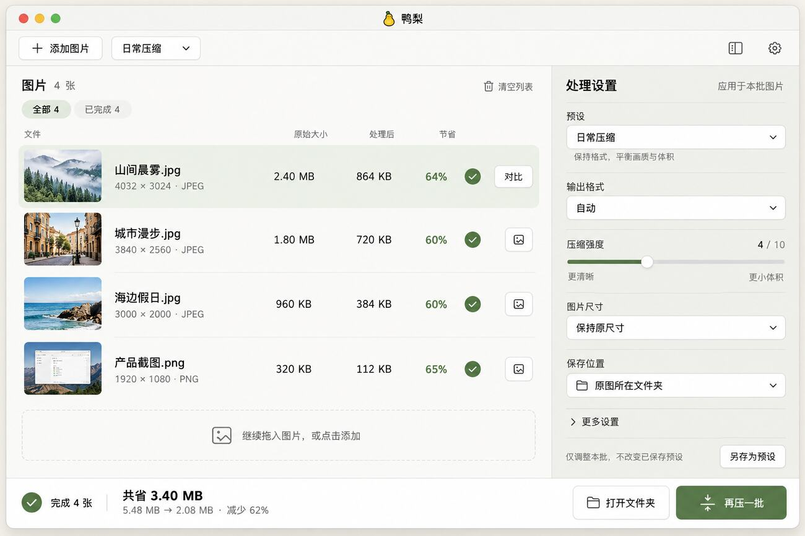
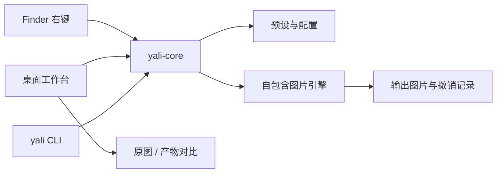

<p align="center">
  
</p>

<h1 align="center">鸭梨 Yali</h1>

<p align="center">右键压一下，图片没鸭梨。</p>

<p align="center">
  <a href="https://github.com/freemantc9527/yali/blob/main/LICENSE"></a>
  <a href="https://github.com/freemantc9527/yali/releases"></a>
  <a href="https://github.com/freemantc9527/yali/actions/workflows/release.yml"></a>
  <a href="https://github.com/freemantc9527/yali"></a>
</p>

鸭梨（Yali）是一个面向 macOS 的本地图片压缩与转换工具。它把常用操作放进 Finder 右键菜单、桌面工作台和 CLI，处理图片时不必打开终端，也不必记住一长串参数。

> 当前公开版本是 `0.1.0-alpha`。它适合尝鲜和反馈，不代表所有 macOS 入口都完成了人工验收。

## 下载

从 [GitHub Releases](https://github.com/freemantc9527/yali/releases) 下载 DMG。根据 Mac 的处理器选择对应文件：

| Mac 类型 | 下载 | 架构 |
| --- | --- | --- |
| Apple Silicon（M1、M2、M3、M4 等） | [Yali_0.1.0-alpha_macos_arm64.dmg](https://github.com/freemantc9527/yali/releases/download/v0.1.0-alpha/Yali_0.1.0-alpha_macos_arm64.dmg) | arm64 |
| Intel Mac | [Yali_0.1.0-alpha_macos_x86_64.dmg](https://github.com/freemantc9527/yali/releases/download/v0.1.0-alpha/Yali_0.1.0-alpha_macos_x86_64.dmg) | x86_64 |

不知道自己的架构时，在“ → 关于本机”查看芯片信息。也可以在终端运行 `uname -m`，输出 `arm64` 表示 Apple Silicon，输出 `x86_64` 表示 Intel。

每个 Release 还提供构建记录和 `SHA256SUMS`。发布包由 GitHub Actions 从固定提交分别构建，当前 App 使用 ad-hoc 签名，未进行 Developer ID 签名或 Apple 公证。

## 项目缘起

macOS 持续升级后，一些多年没有适配 Apple Silicon 的老应用逐渐退出日常工作流。寻找替代品是一种办法，自己做一个顺手的工具也是一种办法。

图片压缩和格式转换本来可以交给 ImageMagick 等命令行工具，但每次处理都要打开终端、定位目录、回忆参数。需要处理不同目录下的多张图片时，这个过程更费时间。把常用操作放到图片右键菜单里，才更符合日常使用习惯。

鸭梨最初是一个自用工具，后来逐步扩展为一个公开的开源项目：一边解决自己的图片处理需求，一边学习 macOS 应用、跨平台代码、自动化构建和开源项目维护。项目会长期保持 alpha 形态，功能和文档按照实际完成情况持续更新。

## 功能

| 入口 | 适用场景 | 当前能力 |
| --- | --- | --- |
| Finder 右键 | 偶尔处理一张或一批图片 | “鸭梨 · 压一下”保持原格式压缩，“鸭梨 · 转 JPG”输出 JPEG |
| 桌面工作台 | 调整参数、批量处理、查看结果 | 队列、预设、尺寸调整、输出策略、结果列表和原图 / 产物对比 |
| CLI | 脚本、自动化和批处理 | 与桌面应用共用 Rust 内核和 Profile |
| Dock / 打开方式 | 从其他应用投递图片 | 支持拖到应用图标，或在“打开方式”中选择 Yali |
| 剪贴板与监视目录 | 重复处理固定来源 | 可在设置中启用，完成后发送系统通知 |

内置预设包括日常压缩、转 JPG、缩小尺寸和无损归档。默认保留原图，输出位置、文件后缀和较大文件策略可以调整。发布包会携带图片处理所需运行时，用户不需要安装 Homebrew 或 ImageMagick。用于 SSIM 质量分数的 FFmpeg 是可选外部工具，没有它也不影响图片处理和视觉对比。

## 界面预览



上图是当前工作台的设计预览，用来展示布局、信息层级和操作路径。具体行为以当前构建和 [项目状态](docs/STATE.md) 为准，预览图中的示例文件和数值不代表固定数据。

鸭梨的三个主要入口由同一个 Rust 内核驱动，并使用同一套 Profile：



## 安装与使用

### 使用发布包

从上面的 Releases 页面下载对应架构的 macOS DMG。打开 DMG，将 `Yali.app` 拖到 `/Applications/` 或 `~/Applications/`，再打开应用。在“设置 → 自动化”中安装或修复 Finder 右键操作。

每个 Release 会单独列出架构、最低系统、已验证格式和已知限制。当前公开包记录的最低 macOS 版本为 15.0，已通过两架构云端构建与自动检查。维护者本机环境为 macOS 27.2，Finder 等原生交互及低版本系统仍待人工验收。应用使用 ad-hoc 签名，不包含 Developer ID 或公证。

### 首次打开 ad-hoc App

ad-hoc 签名用于本地开发、测试和个人分发，不等同于 Developer ID 签名。首次打开时，优先使用 Finder 右键菜单中的“打开”；如果系统仍阻止启动，到“系统设置 → 隐私与安全性”中选择“仍要打开”。

从终端启动已安装的 App：

```bash
open "/Applications/Yali.app"
```

如果 DMG 或 ZIP 来自浏览器，macOS 可能给 App 添加下载隔离标记。只针对该 App 移除标记后再启动：

```bash
APP="/Applications/Yali.app"
xattr -dr com.apple.quarantine "$APP"
open "$APP"
```

可以先检查当前签名，不需要重新签名：

```bash
codesign --verify --deep --strict --verbose=2 "/Applications/Yali.app"
```

App 内的 CLI 位于 `Contents/MacOS/yali`，可直接调用：

```bash
APP="/Applications/Yali.app"
"$APP/Contents/MacOS/yali" --help
"$APP/Contents/MacOS/yali" profiles show default
"$APP/Contents/MacOS/yali" compress "/path/to/photo.jpg" --profile default
```

### 从源码构建

开发环境需要 macOS、Command Line Tools、Rust、Node.js、pnpm、Python 3 和 Tauri 2 CLI，不需要完整 Xcode。依赖安装和版本约束见 [工具链说明](docs/TOOLCHAIN.md)。

```bash
brew bundle --file "Brewfile"
pnpm --dir ui install --frozen-lockfile
bash scripts/dev.sh          # 桌面开发模式
bash scripts/dev.sh --web    # 浏览器演示模式
bash scripts/build.sh        # 构建自包含 Yali.app
```

浏览器模式用于界面调试，不执行真实本地压缩，也不能替代 Finder 服务和原生窗口验收。构建脚本会生成 `target/release/bundle/macos/Yali.app`，并检查真实前端、包内动态库、图片 UTI 和签名。

### CLI 示例

```bash
cargo run -p yali-cli -- profiles show default
cargo run -p yali-cli -- compress "/path/to/photo.jpg" --profile default
```

安装好的 App 会提供稳定入口 `~/.yali/bin/yali`。预设、设置、撤销记录和缓存默认位于 `~/.yali/`，需要隔离数据目录时可以设置 `YALI_HOME`。

## 支持范围

- **macOS** 是当前主平台，Finder 集成、桌面工作台、CLI 和自包含运行时都以 macOS 为主线维护。
- **Windows** 处于实验阶段，只计划先保证 JPEG、PNG、GIF、WebP、BMP、TIFF 等基本图片处理。打包、WebView2、系统集成和完整格式兼容性尚未在真实 Windows 环境验证。
- HEIC、AVIF、JPEG XL 等格式的可用性取决于平台、内置引擎和具体构建产物。每个版本的发布说明会记录实际验证范围。

## 项目文档

| 文档 | 适用对象 | 内容 |
| --- | --- | --- |
| [开发指南](docs/DEVELOPMENT.md) | 贡献者 | 环境准备、运行、测试和调试入口 |
| [贡献指南](CONTRIBUTING.md) | 贡献者 | Issue、代码、文档和 PR 要求 |
| [项目状态](docs/STATE.md) | 用户和维护者 | 已实现能力、待验收事项和已知限制 |
| [架构说明](docs/ARCHITECTURE.md) | 贡献者 | 内核、CLI、Tauri、UI 和系统入口的关系 |
| [产品设计](docs/DESIGN.md) | 贡献者 | Profile、数据目录、处理策略和产品边界 |
| [跨平台支持](docs/CROSSPLATFORM.md) | 用户和维护者 | macOS、Windows、Linux 的支持声明 |
| [工作流](docs/WORKFLOW.md) | 维护者 | 开发任务、验收记录和文档归档方式 |
| [版本规范](docs/VERSIONING.md) | 维护者 | 版本号、分支、提交和源码追溯 |
| [发布指南](docs/RELEASING.md) | 维护者 | GitHub Actions、构建产物和发布门槛 |
| [变更记录](docs/CHANGELOG.md) | 用户 | 每个版本的用户可见变化 |
| [架构决策](docs/decisions/README.md) | 贡献者 | 已接受的技术选型和取舍 |

## 参与项目

欢迎报告可复现问题、补充真实图片格式的验证结果、改善文档、完善 Windows 支持，或提交代码和测试。提交 Issue 或 PR 时，请说明系统版本、CPU 架构、输入格式、复现步骤和实际命令，并先阅读 [贡献指南](CONTRIBUTING.md) 与 [开发规则](AGENTS.md)。

## 许可证

本项目使用 [Apache-2.0](LICENSE) 许可证。第三方运行时和图片引擎的许可证会随构建产物一并保留。
