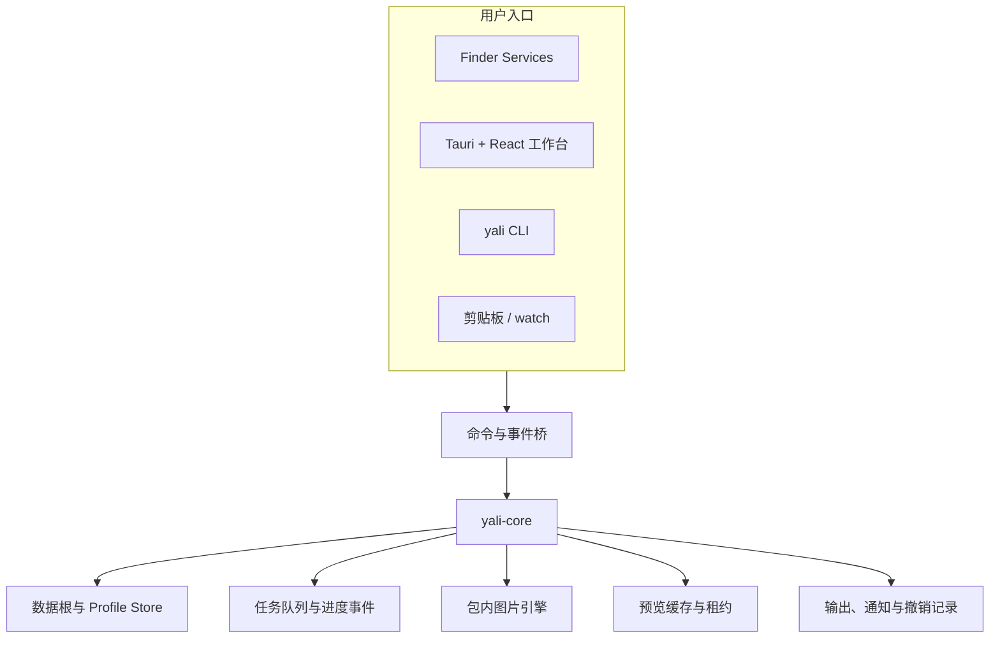

# 架构说明

鸭梨把图片处理规则集中在 Rust 内核，桌面应用、Finder 服务和 CLI 只负责不同的入口和交互。这样同一份 Profile 在不同入口得到相同的输出策略，也方便在没有桌面环境时运行批处理。

## 内核

`yali-core` 负责 Profile 校验、预设读取、图片引擎调用、并发队列、输出目录策略、缓存发布、撤销清单和系统入口所需的稳定数据结构。所有持久化路径从数据根解析，迁移使用临时文件和原子发布，避免中断后出现半写入配置。

图片处理运行时由构建脚本收集到 App 内，运行时不回落到开发机的 Homebrew 或源码目录。FFmpeg 仅作为可选的外部质量分析工具，不参与基本处理链路。

## 入口层

- **CLI** 使用 `clap` 解析命令，提供 Profile、压缩、诊断和脚本友好的输出。
- **Tauri 壳层** 把内核命令映射给 UI，处理打开文件事件、托盘、通知、剪贴板和 watch 生命周期。
- **React UI** 负责队列、参数编辑、预设管理、设置和原图 / 产物对比，不复制内核校验规则。界面只做提前提示，最终结果以内核返回为准。
- **Finder Services** 使用稳定的 `~/.yali/bin/yali` 入口调用 CLI，模板只接收文件并传递固定 Profile，不在右键菜单里询问复杂参数。

## 数据与安全边界

默认数据根为 `~/.yali/`，包括 `profiles/`、`settings.json`、`data/undo/`、`cache/` 和日志。`YALI_HOME` 用于测试隔离和多环境运行。原图默认不覆盖，输出文件名和较大文件策略由 Profile 控制。

缓存和临时工作区通过跨进程租约保护活动预览，回收器不跟随符号链接。剪贴板访问限定在主线程，并同时按系统 changeCount 与内容摘要去重。watch 忽略自身产物，并等待文件的 mtime 和 size 稳定后才提交任务。

## 构建边界

`scripts/build.sh` 依次构建 Rust、真实前端、包内图片引擎和动态库，重定位依赖、保留第三方许可证，生成 ad-hoc 签名的 `Yali.app`，并检查 bundle、UTI 和依赖闭包。Release 由 GitHub Actions 在 Apple Silicon 和 Intel runner 上分别构建，两个架构必须来自同一提交。
